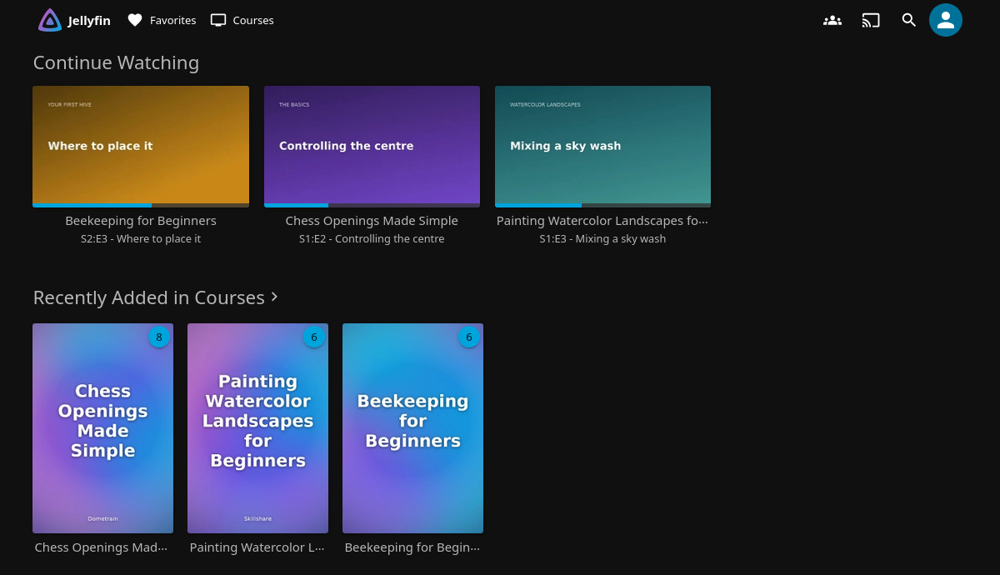
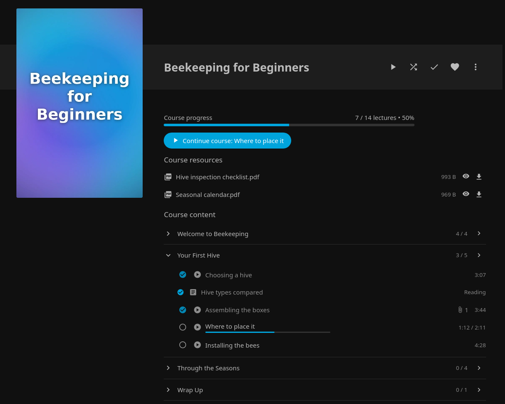
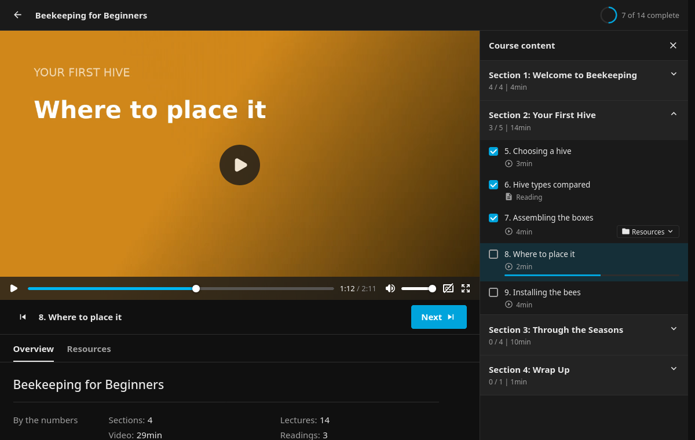
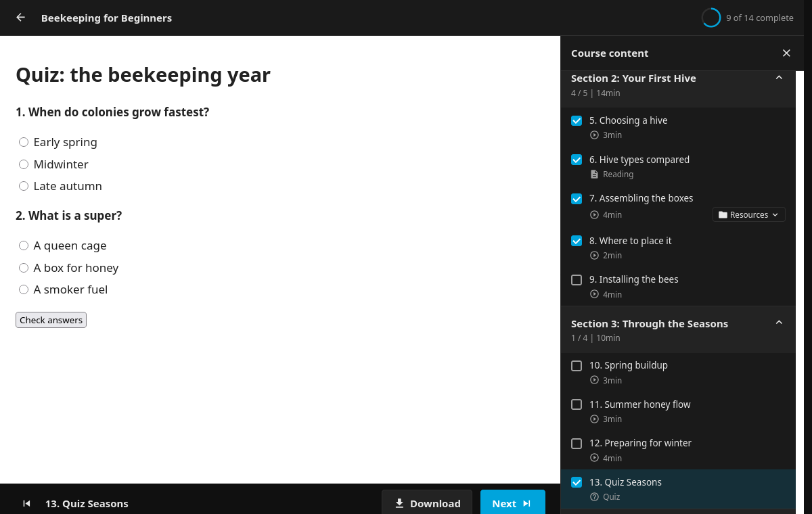
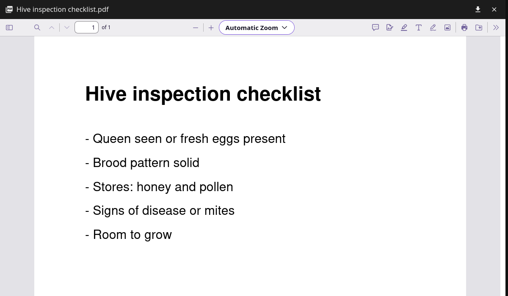
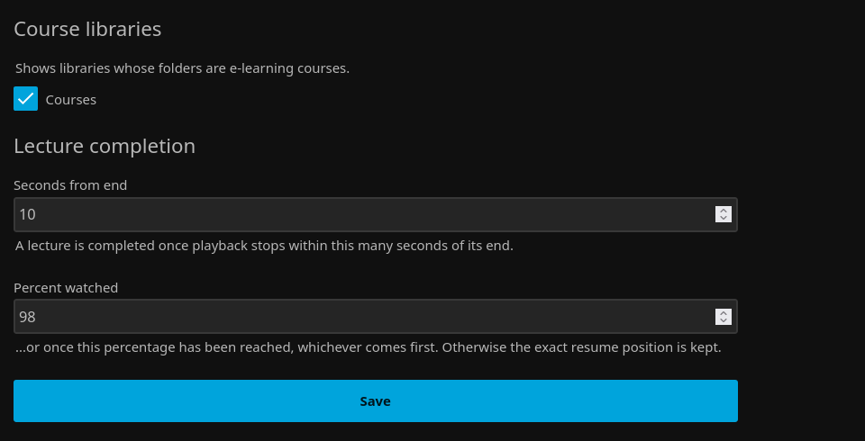

# JellyLearning

> [!WARNING]
> # ⚠️ Early software: not well tested. Use it carefully.
>
> **This plugin has had very little testing.** It has automated tests (unit and snapshot tests)
> and has been tried by hand on one Jellyfin 12.2 test instance, and that is all. It has not been
> run by other people, on other setups or Jellyfin versions, or on large libraries.
>
> It changes how the items in your course libraries are titled and ordered, and it decides when a
> lecture counts as watched, so expect bugs, and expect that some of its changes to watched state
> and resume positions may be wrong.
>
> - **Back up** Jellyfin's config and database before installing it.
> - **Try it on a test Jellyfin first**, not your main server.
> - Enable it only for a library that holds just your courses.
> - Don't rely on it for anything you can't redo, and please
>   [report problems](https://github.com/Trevo525/JellyLearning/issues).

JellyLearning is a Jellyfin plugin for watching exported e-learning courses (Udemy, Skillshare,
Dometrain, Craftsy, …) like on the course site: sections and lectures in course order, exact
resume positions, course progress, and viewable/downloadable resources. See [PLAN.md](PLAN.md) for the design and roadmap.

Targets **Jellyfin 12.2** (.NET 10). Requires the
[File Transformation](https://github.com/IAmParadox27/jellyfin-plugin-file-transformation) plugin.

## Screenshots

All screenshots show a made-up demo library: invented courses with generated placeholder videos.

**Courses in Jellyfin**: generated covers, and Continue Watching resumes each course at the exact
position you stopped.



**Course page**: progress, course resources (view or download), and the outline of all sections
and lectures, with completion marks and resume positions.



**Course player**: the course outline beside the video like on the course site, per-lecture
resources, and the lecture resumes where you left it.



**Readings and quizzes** open inline and count towards the course progress.



**Resources** open in a viewer (PDF, HTML, Markdown, text, images) or download.



**Settings**: which libraries are course libraries, and when a lecture counts as complete.



## Install

Jellyfin **12.2** only (the plugin is built against 12.2's packages).

1. Install **File Transformation** (3.0.3.0 or later for 12.2) from its plugin repository
   `https://www.iamparadox.dev/jellyfin/plugins/manifest.json` (Dashboard → Plugins →
   Repositories). It adds the course UI to the web client.
2. Download `E-Learning_<version>.zip` from a [release](https://github.com/Trevo525/JellyLearning/releases), or build it with
   `build/package.sh <version>`, and unzip it into Jellyfin's plugins folder, so you get
   `<config>/data/plugins/E-Learning_<version>/` (linuxserver image: `/config/data/plugins/`;
   Debian packages: `/var/lib/jellyfin/plugins/`).
3. Restart Jellyfin. To update, delete the old `E-Learning_*` folder, unzip the new one, restart.

## Server setup

1. Install File Transformation and this plugin (see Install), restart.
2. Create a **Shows** library for the courses (one folder per course). In its settings turn off
   all internet metadata/image fetchers (TheMovieDb, OMDb) and the NFO saver. Courses and
   sections get a generated cover (title on a purple/blue gradient); to use your own, put a
   `poster`, `cover` or `folder` image (jpg/png) in the course folder. Covers follow the folder names:
   after renaming a course or section folder, a normal library scan draws the new one.
3. Dashboard → Plugins → E-Learning → tick the library under *Course libraries*, save, then
   scan the library (Dashboard → Libraries → Scan all libraries).
4. Reload the web client once (the course UI is injected into it by File Transformation):
   course, section and lecture pages then show progress, the full outline and resources, and
   **Start/Continue course** opens the Udemy-style course player.
5. Optional: Dashboard → Playback → Resume → *Max resume percentage* = 100. The plugin enforces
   its own completion rule for course lectures regardless (settings page: "Lecture completion");
   this only avoids a brief "watched" flicker while a lecture plays.

## Development

Needs Docker; the .NET 10 SDK and Python 3 only for the parts you run on the host.

```bash
dotnet test                                      # unit + snapshot tests (no Jellyfin needed)
docker compose -f dev/compose.yaml up -d         # dev Jellyfin at http://localhost:8096, set up
./dev/deploy.sh                                  # rebuild the plugin into it and restart
build/package.sh 0.1.0                           # release zip -> artifacts/release/
```

`docker compose -f dev/compose.yaml up -d` builds the plugin (in a .NET SDK container) into the
dev Jellyfin 12.2's plugins folder, generates the test courses, starts Jellyfin and sets it up:
admin account, File Transformation, a "Course Fixtures" library ticked in the plugin settings,
an API key. The logins and the key end up in `dev/.env`. Details, options (your own courses,
another port or state folder) and the dev scripts are in [dev/README.md](dev/README.md).

Releases: push a tag `vX.Y.Z`; the GitHub Actions workflow (`.github/workflows/build.yml`) runs
the tests, builds the zip with `build/package.sh` and attaches it to a GitHub release. Every push runs the
tests. Bump `version` and `changelog` in `build.yaml` with each release.

Against the running dev instance (they read `dev/.env` themselves):
`dev/verify-library.py` checks every course in Jellyfin against the parser,
`dev/test-progress.py` checks the completion rule with simulated playback and
`dev/test-api.py` checks the `/ELearning` API (run all three after each change and after server
upgrades); `dev/ui-view.py` prints courses as jellyfin-web lists them;
`dev/library-report.sh` dumps the raw database view.

## Third-party

The course player bundles [hls.js](https://github.com/video-dev/hls.js) 1.7.4 (light build,
Apache-2.0, `Jellyfin.Plugin.ELearning/Web/ThirdParty/`, license next to it), and its icons
are Material Icons paths (Apache-2.0).
